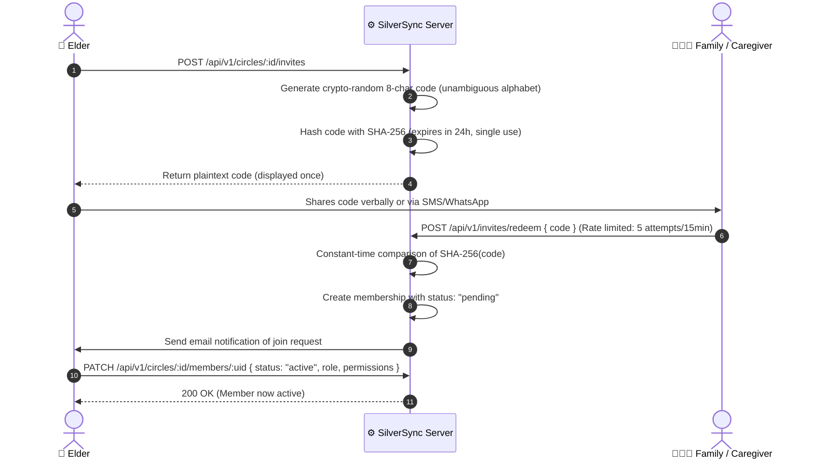

# 🏗️ SilverSync Architecture & Technical Design

## 1. Executive Overview
**SilverSync** is an Elderly Care & Medication Management Platform designed with a strict **Elder-at-the-Centre** philosophy.
While family members and caregivers collaborate on healthcare tasks, the elderly person retains full ownership and control over their profile, membership, and medication changes.

---

## 2. Layered Architecture Pattern

The system strictly follows a clean 4-tier backend architecture:

```
[ HTTP Request ]
       │
       ▼
 [ Middleware ]       --> Auth, RateLimiting, Validation (Zod), Permission Checks
       │
       ▼
  [ Routes ]          --> Endpoint definitions & middleware mounting (/api/v1/...)
       │
       ▼
[ Controllers ]       --> HTTP request/response handling, status codes, error formatting
       │
       ▼
  [ Services ]        --> Pure business logic, authorization rules, idempotency, AI coordination
       │
       ▼
[ Repositories ]      --> Firestore database operations, queries, transactions, batch writes
       │
       ▼
 [ Cloud Firestore ]
```

---

## 3. Roles and Permission Matrix

Each Care Circle has three distinct membership roles and granular permissions granted by the elder:

| Role | Permission | View Meds & Doses | Log Dose for Elder | Propose Med Change | Direct Med Change | Manage Appointments | View Post-Visit Notes | Manage Members |
| :--- | :--- | :---: | :---: | :---: | :---: | :---: | :---: | :---: |
| **ELDER** | `all` | ✅ Yes | ✅ Yes | N/A (Direct) | ✅ Direct | ✅ Yes | ✅ Full (Sets sharing) | ✅ Full (Approve/Revoke) |
| **FAMILY** | `view_only` | ✅ Yes | ❌ No | ❌ No | ❌ No | ❌ No | 👁️ If shared by elder | ❌ No |
| **FAMILY** | `manage_medicines` | ✅ Yes | ✅ Yes (loggedBy) | ✅ Propose only | ❌ Needs Approval | ❌ No | 👁️ If shared by elder | ❌ No |
| **FAMILY** | `manage_appointments`| ✅ Yes | ❌ No | ❌ No | ❌ No | ✅ Yes | 👁️ If shared by elder | ❌ No |
| **CAREGIVER**| `view_only` | ✅ Yes | ❌ No | ❌ No | ❌ No | ❌ No | 👁️ If shared by elder | ❌ No |
| **CAREGIVER**| `manage_medicines` | ✅ Yes | ✅ Yes (loggedBy) | ✅ Propose only | ❌ Needs Approval | ❌ No | 👁️ If shared by elder | ❌ No |
| **CAREGIVER**| `manage_appointments`| ✅ Yes | ❌ No | ❌ No | ❌ No | ✅ Yes | 👁️ If shared by elder | ❌ No |

### Key Architectural Invariants:
1. **Elder Authority**: Non-elders cannot directly alter medication details or schedules. Any edit is captured as a `proposedChange` document with status `pending`. It takes effect ONLY when the elder explicitly clicks **Approve**.
2. **Accountability**: Caregivers and family can log a dose as taken on the elder's behalf, but it is immutably tagged with `loggedBy: <uid>`.
3. **Immediate Revocation**: An elder can revoke any member instantly. Revoked status is enforced on every single request through server-side middleware.
4. **Selective Privacy**: Post-visit clinical notes carry a `sharedWith: [uid1, uid2]` array curated by the elder. Non-authorized members receive `403 Forbidden`.

---

## 4. Secure Joining Flow (Passcode-based)



---

## 5. Standardized API Response and Error Shape

All endpoints strictly follow a uniform JSON structure. Stack traces are never exposed to clients.

### Success:
```json
{
  "success": true,
  "data": { ... }
}
```

### Error:
```json
{
  "error": {
    "code": "PERMISSION_DENIED",
    "message": "Only the elder or members with manage_medicines permission can perform this action."
  }
}
```

Standard Error Codes:
- `UNAUTHORIZED` (401)
- `FORBIDDEN` / `PERMISSION_DENIED` (403)
- `NOT_FOUND` (404)
- `VALIDATION_ERROR` (422)
- `RATE_LIMIT_EXCEEDED` (429)
- `INTERNAL_SERVER_ERROR` (500)

---

## 6. Prompt Injection Defense & AI Safety

All AI features (Gemini API) follow defensive architecture:
1. **User Text Treated Strictly as Data**: Prompts use XML delimiters (`<patient_notes>`, `<medication_list>`) and explicit instruction hierarchies separating system directions from untrusted user content.
2. **Output Schema Validation**: Gemini outputs are enforced using JSON schemas and validated with Zod before being returned or stored.
3. **Mandatory Disclaimer**: Every AI-generated output is permanently stamped with `"AI-generated, not medical advice. Confirm with your doctor."`
4. **No Auto-Execution**: If Gemini detects a dosage adjustment in post-visit clinical notes, it creates a `proposedChange` record requiring elder confirmation. It NEVER directly mutates the medication schedule.
